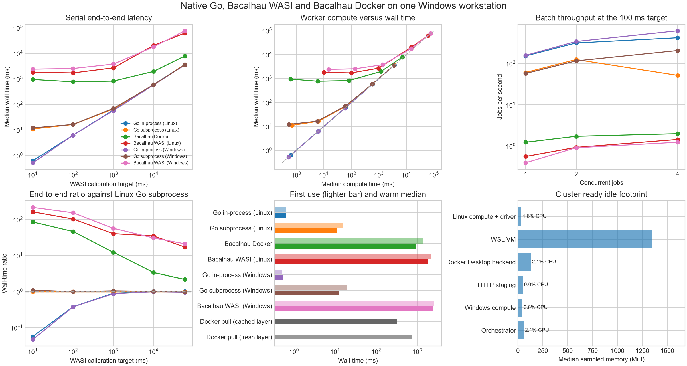
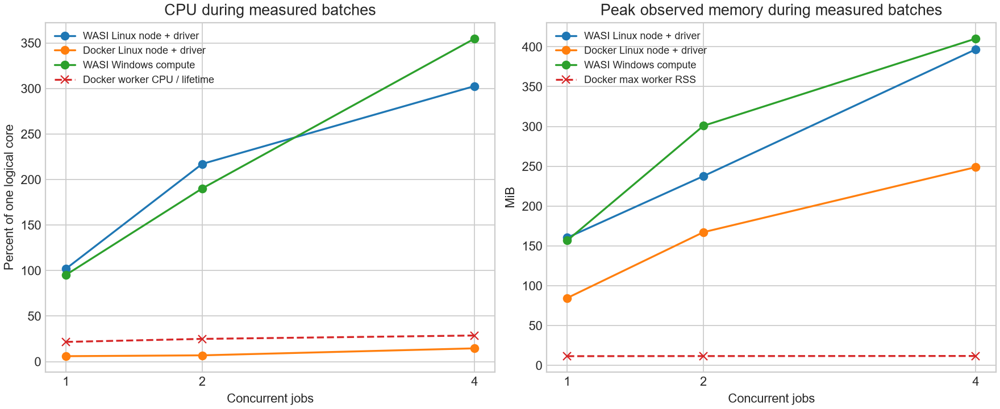

# ADR-0001 technical case — Excluding direct native Go jobs

Date: 2026-11-16. Decision context: [ADR-0001](0001-adopt-go-wails-v3-bacalhau.md). Evidence baseline: PoC merged in `91ebfb6e0a71b44f6ee8b09cdd52ecaf2cc0876c` through [PR #10](https://github.com/vmenezesdev/viii-digital-evidence-workbench/pull/10). Operational acceptance remains open in [issue #9](https://github.com/vmenezesdev/viii-digital-evidence-workbench/issues/9).

## Decision and question

Use Bacalhau for evidence-processing jobs on the workstation and on authorized remote nodes. WASI is the portable, Docker-free option for compatible workers. Docker is the performance-oriented option for native workers and specialized dependencies. Exclude direct in-process and native subprocess jobs from the product, including as a fallback when Bacalhau is unavailable.

This case supports the job-runtime decision independently of the application stack. Go is the implementation language of the measured workers, not a requirement imposed by Bacalhau. The Go + Wails application-layer choice is recorded separately in [ADR-0002](0002-adopt-go-wails-v3.md).

The question is whether accepting a runtime on every workstation is justified by keeping the same job model as the product grows from local use to LAN, customer-controlled BYOC and authorized managed compute. The project chooses that direction. The experiments establish the local performance price and some placement/recovery behavior; they do not establish lower total product engineering or operating cost.

“Native jobs” here means execution that bypasses Bacalhau. Go application services, validation, hashing, persistence and UI operations remain ordinary application code. A Go worker compiled to a native executable inside a Bacalhau Docker job is within the decision. Native benchmark executors remain comparison tools.

## Competing designs

| Concern | Direct native local jobs + Bacalhau remote jobs | Bacalhau local and remote jobs — selected |
| --- | --- | --- |
| Local startup and latency | In-process work avoids scheduler, staging and process startup. A subprocess adds process startup but still avoids a local cluster. | Local jobs pay submission, worker acquisition/startup and result observation costs. WASI also paid module compilation in the measured configuration. |
| Installation and updates | Basic local processing needs no Bacalhau runtime. Remote capability adds another deployment path later. | Every processing workstation needs a managed runtime and workers from the start. Docker adds a daemon and images only on nodes using that capability. |
| Worker delivery | Shared Go logic is possible, but native artifacts target OS/architecture or ship inside the desktop executable. Remote workers need their own packaging. | Compatible WASI modules offer a portable artifact across supported nodes. Docker images retain native execution with platform-specific builds. Both still need versioning and integrity verification. |
| Lifecycle | Direct calls can be synchronous and small. Durable long-running local jobs need cancellation, restart/recovery and state semantics aligned with the remote path. | One scheduler/job API for placement, observation and cancellation. VIII still owns attempts, reconciliation, explicit retry intent and domain-level history. |
| Failures and isolation | In-process workers share the desktop process and its failure boundary. Subprocesses provide process separation; additional restrictions require explicit design. | Work runs in the chosen engine's execution boundary. Actual WASI/container permissions, node trust and resource limits still need validation; neither engine alone guarantees evidence security. |
| Evidence policy and provenance | Can preserve hashes, source linkage and independent records, as the PoC demonstrated. These capabilities do not require Bacalhau. | The same evidence authorization and provenance rules apply to both engines and every placement. Scheduling admission never grants evidence access. |
| Roadmap cost | Two execution paths must remain behaviorally consistent. This does not require two parsers or two schedulers; shared domain code and adapters can reduce duplication. | Intends to reduce lifecycle divergence across local/LAN/BYOC. Adds immediate operational work. Net engineering savings remain unmeasured. |

Native Go is a technically viable alternative. Rejecting it is a product architecture choice about lifecycle consistency and worker portability, not a finding that native execution cannot be distributed, secured or traced.

## Experiment design and evidence

The executor experiment used one Windows 11 workstation, an i5-12450HX (8 cores, 12 logical processors), 15.73 GiB host RAM, Docker Desktop/WSL2 and a Linux compute container. Go 1.27.4 built Windows, Linux and preview1 WASI artifacts. Bacalhau v1.9.5 was pinned to revision `3a6a73aa6529755ac2c9d96a771f0566ff3ee5da`. The [environment record](../poc/results/executor-comparison/environment.json) contains artifact identities, sizes and runtime versions; the [control environment](../poc/results/executor-comparison/control/environment.json) includes the independent fresh-image acquisition.

The worker hashes deterministic input and runs a xorshift arithmetic chain. Within each comparison cell, every executor receives identical bytes and iteration count. “10 ms”, “10 s” and “60 s” are WASI calibration targets, not equal durations on every executor. Native and WASI compute very different amounts per wall second. This is a synthetic CPU experiment, not a representative UFDR/OCR/STT performance claim.

The sweep completed 546 measured jobs across seven execution paths; a one-core control added 84, totaling 630 verified results. The matrix varies duration, input size and concurrency one factor at a time. It is not a full factorial sweep. Short serial cells have ten samples; long serial cells have two. The control retains two short Windows native results with zero compute time but excludes those timings from statistics. [Methodology and reproduction](../poc/executor-comparison.md) · [Sweep statistics](../poc/results/executor-comparison/summary.json) · [Control statistics](../poc/results/executor-comparison/control/summary.json).

### Latency: the price of a common job model

Selected serial medians, in milliseconds. Every row uses the same 10 KiB input and iteration count across columns. Values are end-to-end wall time / worker compute time.

| Experiment and target | Linux native subprocess | Bacalhau Docker on Linux | Bacalhau WASI on Linux |
| --- | ---: | ---: | ---: |
| Sweep, 10 ms WASI target | 11.10 / 0.69 | 949.88 / 0.61 | 1,817.52 / 10.21 |
| Sweep, 60 s WASI target | 3,634.49 / 3,621.87 | 7,915.48 / 7,178.21 | 62,515.47 / 60,669.01 |
| One-core control, 10 s WASI target | about 600 / 594 | about 1,420 / 593 | about 11,370 / 9,680 |

The sweep requested 0.5 CPU for Bacalhau jobs. Docker's largest-cell worker ran at about half a logical core, while observed WASI use was about one core. Do not attribute the Docker/native compute gap in that row entirely to containerization. The one-core control measured nearly identical Docker/native compute (593/594 ms); Docker still took about 1.42 s end to end versus about 0.60 s for the subprocess. WASI remained substantially slower for this arithmetic kernel. [Job allocation](../poc/results/executor-comparison/job-configuration.json) · [Raw sweep](../poc/results/executor-comparison/latency.jsonl) · [Raw control](../poc/results/executor-comparison/control/latency.jsonl).

Docker beat WASI at every sampled serial point on the shared Linux node. There is no observed crossover in this range. Native remained faster than both. Increasing WASI job duration reduces the fraction spent outside worker computation, but does not remove the slower computation itself. That distinction prevents claiming that a sufficiently long job automatically makes WASI competitive with native code.

Read the duration axis as a WASI calibration target. Most latency axes are logarithmic. The lower-left ratios use the Linux native subprocess as baseline. First-use and image pulls are separate observations; the graph combines sweep observations with the separate fresh-layer control. The idle panel shows overlapping component scopes, not additive memory requirements or a clean-install minimum.

### Startup, acquisition and resource cost

At the lightest Linux point, traces recorded a median 1,459 ms of WASI compilation, 2.69 ms of instantiation and 14.07 ms in the worker entrypoint. All ten measured WASI jobs in that cell had a compile span. This supports investigating compilation reuse; it does not prove that a deployable cache will remove the cost. Docker events measured 315 ms from container creation to start and 221 ms from start to exit. API spans overlap those intervals and must not be summed as independent stages. [OTLP archive](../poc/results/executor-comparison/otlp-traces.base64.gz) · [Docker lifecycle events](../poc/results/executor-comparison/docker-events.jsonl).

The fresh 5.81 MB worker image layer took 727 ms to acquire from a VM-local registry, separately from job latency. The warm sweep excludes acquisition. This is not an internet download or air-gap test. An earlier Windows-published registry endpoint was unreachable by the daemon; the working setup used VM loopback. Worker availability and staging topology are operational concerns even with a common scheduler. [Pull log](../poc/results/executor-comparison/control/image-pull.log) · [Preflight failure](../poc/results/executor-comparison/preflight-failure.json).

Sweep cluster-ready median memory included 56.9 MiB for the Windows orchestrator, 47.0 MiB for staging, 43.7 MiB for Windows compute, and 32.5 MiB for Linux compute plus driver. Docker Desktop backend processes used 127.4 MiB and the WSL process working set was 1.31 GiB. The VM was already running. These are observations of this topology; the VM, daemon and node scopes overlap. They cannot be summed into a portable product footprint, nor treated as the mandatory cost of Docker-free WASI use. [Resource samples](../poc/results/executor-comparison/resources.jsonl) · [Daemon samples](../poc/results/executor-comparison/docker-daemon.jsonl).

CPU is relative to one logical core, so values above 100% represent multiple cores. The Docker node/driver line excludes the sibling workers and daemon; the separate worker line reports worker CPU relative to its lifetime. Maximum worker RSS is per job, while node memory is a sampled combined process/container scope. Short jobs can fall between snapshots, making sampled peaks lower bounds. The c=4 Windows WASI and Linux Docker CPU estimates used only three and two snapshots respectively. This chart is not evidence that Docker's whole stack costs less than a native local process.

At the 100 ms target, Docker throughput rose from 1.23 to 1.98 jobs/s at concurrency 1 to 4, while Linux WASI rose from 0.55 to 1.44. Native Linux in-process rose from 152.80 to 423.27 jobs/s. Parallelism improved orchestrated throughput in these batches; it did not erase the native advantage. The Linux subprocess c=4 drop came from one short batch and is not an established scaling limit.

### Placement and recovery: what the shared contract buys so far

The [authorized UFDR experiment](../poc/authorized-execution-recovery.md) supplies different evidence from the arithmetic benchmark. It normalized 32 deterministic synthetic messages on native Go and two authorized WASI nodes, preserving matching input/output hashes and source references. VIII denial for an exact evidence digest/node pair caused zero new jobs and zero staging requests even when Bacalhau admitted the node.

After a compute-node kill, the pinned Windows evidence job stayed Running during the 70-second observation window and required cancellation. In the Windows/Linux-container run, the pinned job failed 72.6 seconds after the kill, with no eligible replacement. Service reconstruction found the same accepted job without resubmission, and an explicitly authorized linked retry on A completed with the same result hash. An empty-report control established placement of a replacement execution when A was eligible; it was cancelled before completion. These results do not establish automatic successful failover of an evidence job. [Windows events](../poc/results/issue-9-recovery/windows-native.jsonl) · [Windows/Linux-container events](../poc/results/issue-9-recovery/windows-docker.jsonl).

The common job API is useful, but VIII still needs its own attempt journal, uncertain-submission lookup, persisted cancellation intent, retry lineage and output verification. These are domain/application responsibilities, not evidence that Bacalhau eliminates all lifecycle code. The current adapter accepts one authorized execution and rejects multiple executions; accepting scheduler failover requires preserving every execution and validating every eligible placement.

All completed topologies share one physical workstation. The handler also normalizes locally to validate input and compare returned results, so the recovery experiment cannot demonstrate an offloading speedup. The 2 KiB description-stdout return limit accommodated 32 repetitive messages with gzip/base64; a 48-message trial exceeded it. Larger results require an authenticated artifact-return contract. A configured worker digest is not proof of the artifact actually executed.

## Why the project rejects the faster local path

The native-first alternative could keep the current synchronous route small, share the parser and preserve provenance. The measurements support that local advantage. It is rejected because the desired product must carry the same processing capability and lifecycle from one workstation to authorized heterogeneous nodes without making local native jobs a separate supported execution mode.

The selected design concentrates job submission, placement, observation and cancellation at the Bacalhau boundary. Go domain logic can build as WASI for portability or as a native Docker worker when performance/dependencies justify it. Docker remains optional; native dependencies inside Docker do not reintroduce a direct desktop executor.

This exchanges immediate local simplicity and speed for an intended reduction in execution-path divergence over the roadmap. It accepts a managed runtime, worker distribution, WASI startup/compute penalties and engine-specific packaging. It does not claim that two adapters necessarily duplicate the parser or require a competing scheduler, or that Bacalhau solves evidence authorization, secure transfer, updates or application recovery automatically. Lower total engineering cost remains a hypothesis.

## Consequences, implementation gap and remaining gates

This revision changes the architecture documents. The merged PoC still exposes native local execution and performs normalization in the desktop handler. Removing that job mode, updating its callers/UI/tests and replacing PoC-only local result comparison are implementation work; they have not occurred in this revision. Preserve historical measurements and native benchmark executors when aligning the product. The benchmark Docker path is not yet a desktop Docker product mode.

| Gate | Evidence still needed |
| --- | --- |
| Basic workstation | Clean Windows installation with managed Bacalhau/WASI, no developer toolchains, no CLI and no Docker; runtime failure/restart diagnostics; offline behavior tested separately. |
| Runtime latency | Acceptable end-to-end job latency for a customer-relevant workload. No latency budget has been established by this benchmark. Desktop visual verification is a separate application-layer gate under ADR-0002. |
| Worker and artifact trust | Verified executed artifacts, authenticated staging and larger result return, exact app/runtime/worker attribution and compatibility across upgrades. |
| Distributed operation | Two physical hosts, network interruption, actual orchestrator outage/restart, explicit authorized retry and preserved provenance. |
| Lifecycle and updates | Managed startup/shutdown, maintenance admission, independent worker upgrades, failed-update rollback and state preservation. |
| Total product cost | Record installer/runtime/update components, failure procedures and engineering changes needed to add LAN/BYOC. Compare against the native baseline without building a second production execution architecture. |

Revisit the decision if representative workload latency, footprint or managed lifecycle cost is unacceptable, WASI compatibility makes the basic Docker-free workflow impractical, or another design demonstrates lower lifecycle cost while preserving the roadmap. Do not silently add a native fallback. A future direct native product executor requires a new decision backed by these trade-offs.

## Reproduce and inspect

Use the prerequisites and pinned artifacts in the [executor report](../poc/executor-comparison.md#environment-and-reproduction) and [recovery report](../poc/authorized-execution-recovery.md#reproduction-on-one-host). The benchmark runner is [benchmark-executors.ps1](../../scripts/benchmark-executors.ps1); graph/statistics generation is [report-executors.py](../../scripts/report-executors.py). The archived figures above are reused unchanged, with their measurement limitations retained. This revision runs no new benchmark.

The earlier reports retain their original native-first recommendations as experiment history. This case and the revised ADR supersede those recommendations, not their measurements. ADR-0001 was **Accepted** on 2026-11-16. The open gates concern implementation and operational readiness; architectural acceptance does not mark them as passed or close issue #9.
