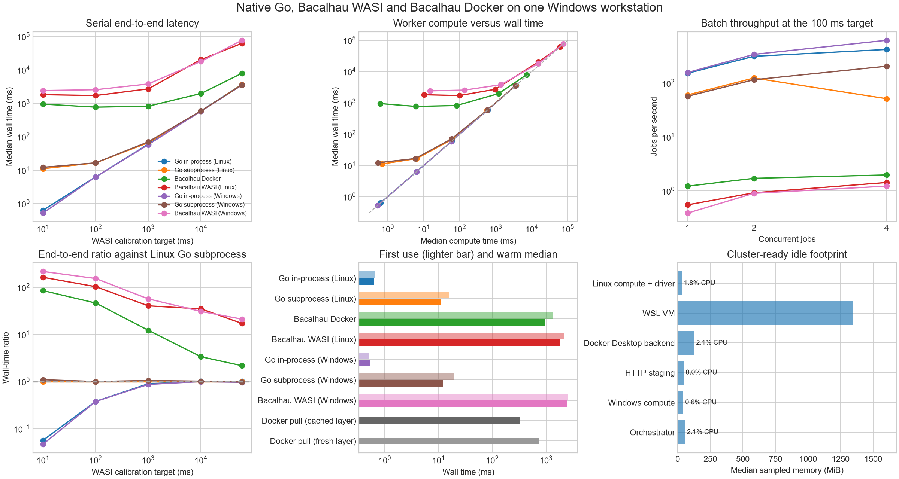
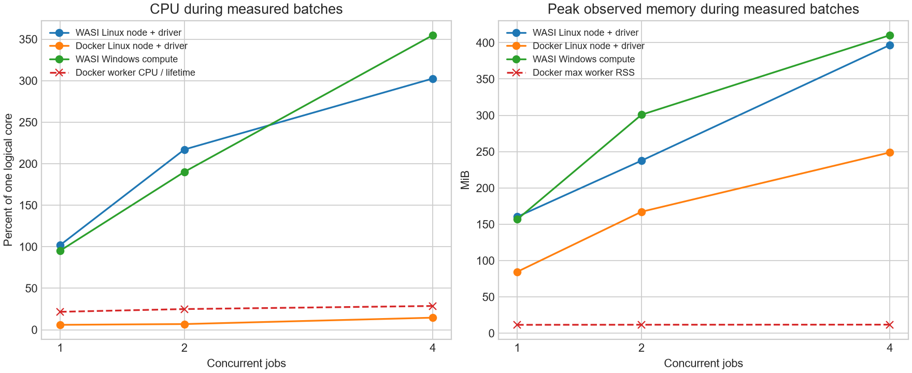

# Native Go, Bacalhau WASI and Bacalhau Docker

> Architecture revision: this report preserves its original measurements and native-first recommendation as experiment history. The [revised ADR and technical trade-off case](../adr/0001-native-execution-tradeoff.md) supersede that recommendation with Bacalhau local/remote jobs, portable WASI and optional performance-oriented Docker. Direct native jobs remain a benchmark baseline; product implementation alignment is pending.

The runs took place on 2026-11-16 in America/Fortaleza. Raw timestamps use UTC. The [prior latency spike](distributed-latency.md) ran WASI on Windows and in a Linux compute container. This experiment submits native Linux workers through Bacalhau's Docker engine and compares both engines on the same Linux compute node. [Issue #9](https://github.com/vmenezesdev/viii-digital-evidence-workbench/issues/9) · [PR #10](https://github.com/vmenezesdev/viii-digital-evidence-workbench/pull/10)

## Environment and reproduction

The run used one Windows 11 Home Single Language workstation (10.0.26200.9974), an Intel Core i5-12450HX (8 cores, 12 logical processors), 15.73 GiB of visible host RAM and PowerShell 7.6.9. Docker Desktop 4.42.1 used Docker Engine 28.2.2 on WSL 2.5.9.0, kernel 6.6.87.2, with 12 logical CPUs and 7.62 GiB of VM memory. All workers were built with Go 1.27.4 on Windows with `CGO_ENABLED=0`, `-trimpath` and `-buildvcs=false`, targeting `windows/amd64`, `linux/amd64` and `wasip1/wasm`. Both Bacalhau platforms ran v1.9.5 at revision `3a6a73aa6529755ac2c9d96a771f0566ff3ee5da`. The Windows build identifies wazero v1.12.0. The environment record carries artifact SHA-256 values, byte sizes, image digests and the Docker server version. [Environment](results/executor-comparison/environment.json)

PowerShell starts a Windows orchestrator, a Windows WASI compute node and a Linux compute container advertising both engines. Both nodes stage synthetic inputs from the same Windows HTTP process. The Linux node and driver share a compute container, while the daemon instantiates a sibling container for each Docker job. The native Linux subprocess uses the same executable as the Docker job and launches from the Linux driver. The Windows native runs follow the Linux matrix. Bacalhau's API, NATS and staging listen on Windows loopback, and the registry and its metrics endpoint listen on Linux VM loopback. The trusted, digest-pinned Linux compute container uses the daemon socket. The script uses a dedicated Docker volume so the daemon and Linux node resolve job mount paths identically. Cleanup targets the resources created by the script.

```powershell
pwsh -NoProfile -File scripts/benchmark-executors.ps1 -Matrix sweep -JobCPU 500m -Results .poc-runtime/comparison
pwsh -NoProfile -File scripts/benchmark-executors.ps1 -Matrix control -JobCPU 1 -FreshImage -DockerDesktopDaemon -Results .poc-runtime/comparison-control
py -3.13 -m pip install matplotlib==3.11.2 opentelemetry-proto==1.45.2
py -3.13 scripts/report-executors.py .poc-runtime/comparison-control .poc-runtime/comparison-control/analysis
py -3.13 scripts/report-executors.py .poc-runtime/comparison .poc-runtime/comparison/analysis --cold-control .poc-runtime/comparison-control/analysis/summary.json
```

Use a new results directory for each run. The default executable paths are `C:\Program Files\Go\bin\go.exe` and `C:\Bacalhau\bin\bacalhau.exe`. Access to the Docker Linux daemon and support for a registry bound to its VM loopback are required. The `-FreshImage` run builds and pushes with a separate pinned BuildKit container, then verifies a layer download on the execution daemon. The ordinary build path checks for a missing manifest and records whether the layer was cached. Both paths pin the worker image by manifest digest after acquisition. The worker uses Docker's empty `scratch` base and runs as UID 65532. The script retains the pull separately from the job series and sets `SKIP_IMAGE_PULL=1` during execution. [BuildKit container driver](https://docs.docker.com/build/builders/drivers/docker-container/) · [Pinned Bacalhau Docker executor](https://github.com/bacalhau-project/bacalhau/blob/3a6a73aa6529755ac2c9d96a771f0566ff3ee5da/pkg/executor/docker/executor.go)

## Workload and measurements

Each job hashes deterministic bytes and runs the same xorshift chain from the input digest. The 40,000 rounds per target millisecond come from the earlier WASI pilot. Targets describe the expected order of magnitude on WASI. All executors in a cell use identical rounds and input bytes. Compute includes input hashing and the arithmetic loop. The in-process worker reads an existing memory buffer. The subprocess and orchestrated workers time a file read. Both Bacalhau engines fetch the input via HTTP, and WASI also fetches the module. The Docker worker starts in a new container per job.

The sweep measures all five duration levels (10 ms, 100 ms, 1 s, 10 s, 60 s) at 10 KiB and concurrency 1. It varies input at the 10 ms target (10 KiB, 100 KiB, 1 MiB) and varies concurrent jobs at the 100 ms target (1, 2, 4). The serial short cells have ten measured repetitions. Concurrent cells have twelve, and the 10 s and 60 s serial cells have two. Every cell has one excluded warm-up. The first use of each executor is recorded separately. A batch continuously fills its client slots and counts successful jobs per batch wall second. The `full` mode crosses all three dimensions in 45 cells per path with twelve short samples and at least two long samples per cell. The archived sweep covers nine cells per path.

The client verifies input SHA-256, deterministic output checksum, persisted engine, execution count, node identity and exit status. The analysis also compares logical results between platforms and joins Docker lifecycle events by job and execution IDs to verify the container's image and exit status. Raw stdout hashes identify byte-level responses that also carry variable timings. The driver records failures, keeps nonpositive timings with an exclusion flag and writes medians, nearest-rank p95 and median absolute deviation for successful positive timings. The p95 in a two-sample cell is its observed maximum.

REST submission, polling/retrieval and worker timing use elapsed clocks. The orchestrator timestamps job creation and execution allocation. OpenTelemetry traces measure compute-side URL preparation, WASI compilation, instantiation and entrypoint calls, and Docker API steps. Docker events supply create, start and exit timestamps. Each stage has a distinct boundary. API start can overlap execution for a tiny process, and the WASI entrypoint span includes Go startup, read, compute and output. Clock offsets across Windows and Linux prevent estimating a one-way network duration by subtracting their absolute timestamps. Client polling runs at 100 ms. Staging traces include client-side preparation, while the HTTP service logs handler time.

Resource snapshots track Windows working set and cumulative process CPU, Linux compute-container cgroup usage and Docker workers that are alive during sampling. Linux subprocesses and Docker jobs also report worker CPU time and maximum RSS from `getrusage`. This catches short jobs that finish between snapshots. Sampled peaks are lower bounds for each interval. CPU percentage is relative to one logical core. The WSL process working set encompasses the VM, and the Windows Docker Desktop backend is shared across Docker activity. The dockerd collector reads the daemon's own cumulative process CPU and resident memory from WSL2. It started partway through the sweep and was present from startup in the control. The VM, compute container and daemon memory figures represent overlapping scopes.

## Results

The sweep completed 546 measured jobs across 63 cells. Each result passed equivalence and placement checks where applicable. A preliminary registry setup failed because the daemon could not reach the Windows-published loopback port. The measured runs use the VM loopback. [Preflight failure](results/executor-comparison/preflight-failure.json)

### Serial latency and crossover

Medians in milliseconds, shown as wall time / worker compute time. All columns in a row use the same 10 KiB input and round count.

| WASI target (ms) | Linux in-process | Linux subprocess | Bacalhau Docker | Bacalhau WASI Linux | Windows in-process | Windows subprocess | Bacalhau WASI Windows |
| ---: | ---: | ---: | ---: | ---: | ---: | ---: | ---: |
| 10 | 0.63 / 0.63 | 11.10 / 0.69 | 949.88 / 0.61 | 1,817.52 / 10.21 | 0.52 / 0.52 | 12.20 / 0.54 | 2,416.66 / 14.81 |
| 100 | 6.31 / 6.29 | 16.58 / 6.38 | 771.23 / 5.98 | 1,716.06 / 97.93 | 6.29 / 6.29 | 16.63 / 5.80 | 2,558.72 / 135.74 |
| 1,000 | 60.15 / 60.14 | 66.78 / 59.16 | 821.88 / 81.09 | 2,710.16 / 965.12 | 58.19 / 58.19 | 70.40 / 59.29 | 3,810.08 / 1,391.12 |
| 10,000 | 592.22 / 592.21 | 582.77 / 572.93 | 1,969.17 / 1,182.80 | 20,374.81 / 15,236.88 | 582.83 / 582.83 | 594.55 / 585.03 | 17,964.92 / 15,072.75 |
| 60,000 | 3,676.35 / 3,676.34 | 3,634.49 / 3,621.87 | 7,915.48 / 7,178.21 | 62,515.47 / 60,669.01 | 3,511.00 / 3,511.00 | 3,554.83 / 3,544.63 | 77,062.98 / 75,436.36 |

Docker was faster at every serial point on the shared Linux node. At the lightest point with 10.21 ms of WASI compute, Docker was already 1.91× faster end to end. The sampled range contains no crossover. At the largest point, Docker was 7.90× faster end to end than Linux WASI. Relative to the Linux subprocess, Docker went from 85.55× slower at the lightest point to 2.18× slower at the largest. Linux WASI went from 163.69× to 17.20× slower. The 10 s target actually took about 15 s inside WASI, and Windows WASI took a median 75.44 s of compute at the 60 s target. Frequency, operating system and host load varied between these blocks.

### Engine, scheduling and staging

At the lightest Linux point, Docker's median wall time was 950 ms (p95 1,328 ms, MAD 67 ms) and WASI's was 1,818 ms (p95 2,208 ms, MAD 101 ms). Their median REST submissions took 15 and 13 ms, and the orchestrator's job-creation-to-execution interval was 11 and 14 ms, respectively. The final status request took about 3 and 2 ms. These intervals overlap and the polling cadence adds observation delay.

Docker's create API call took a median 101 ms. Docker events measured 315 ms from creation to start and 221 ms from start to exit, which includes native process startup and exit. The start API took a median 526 ms and overlaps those event intervals. The Linux WASI trace measured 1,459 ms for module compilation, 2.69 ms for instantiation and 14.07 ms for calling the worker at the same point. All ten measured jobs in the cell had a compile span. These traces place most of the short-job cost inside engine startup. The elapsed-minus-compute interval also includes stages such as queueing, artifact preparation, output handling and polling.

Linux staging medians for 10 KiB, 100 KiB and 1 MiB were 7, 9 and 34 ms for Docker and 135, 133 and 155 ms for WASI. The WASI numbers include its module fetch, which took a median 129 ms at the 10 KiB point. Host-local transfer and warmed caches limit what these measurements say about transfer between machines.

### Throughput and resources

Throughput in jobs/s at the 100 ms WASI target and 10 KiB. The c=1 cell ran ten jobs. The c=2 and c=4 batches ran twelve each.

| Concurrent jobs | Linux in-process | Linux subprocess | Docker | WASI Linux | Windows in-process | Windows subprocess | WASI Windows |
| ---: | ---: | ---: | ---: | ---: | ---: | ---: | ---: |
| 1 | 152.80 | 60.55 | 1.23 | 0.55 | 157.72 | 57.23 | 0.39 |
| 2 | 316.10 | 124.87 | 1.72 | 0.92 | 343.31 | 115.96 | 0.90 |
| 4 | 423.27 | 51.59 | 1.98 | 1.44 | 625.93 | 206.70 | 1.23 |

From c=1 to c=4, Docker gained 1.61× in throughput while median per-job latency rose from 0.77 to 1.83 s. Linux WASI gained 2.61× while latency rose from 1.72 to 2.72 s. Linux subprocess throughput at c=4 came from one short batch on the shared host. The raw samples show its launch-time variation, and a repeat is needed before treating the drop as a scaling limit.

| Scope during the 100 ms target | c=1 CPU / peak MiB | c=2 CPU / peak MiB | c=4 CPU / peak MiB |
| --- | ---: | ---: | ---: |
| Linux compute container + driver during Docker jobs | 5.9% / 84.6 | 6.9% / 167.2 | 14.5% / 248.9 |
| Linux compute container + driver during WASI jobs | 102.0% / 160.3 | 217.1% / 237.6 | 302.6% / 396.8 |
| Windows compute process during WASI jobs | 95.3% / 156.8 | 190.2% / 300.8 | 354.8% / 410.3 |
| Docker worker max RSS per job | 11.52 MiB | 11.65 MiB | 11.77 MiB |

The c=4 Windows CPU estimate used three snapshots. The c=4 Linux Docker estimate used two. At the largest target, a Docker worker used 3.65 CPU-s and reached 11.27 MiB RSS. Its cgroup reported a median 49.7% of a logical core. The Linux subprocess used 3.65 CPU-s and reached 28.12 MiB RSS. The Docker job's 7.18 s of measured compute reflects the 0.5 CPU request. Linux WASI used about 102% of one core at that target and peaked at 156.2 MiB in the combined node and driver cgroup. [Recorded default job resources](results/executor-comparison/job-configuration.json)

The sweep's cluster-ready median memory was 56.9 MiB for the Windows orchestrator, 47.0 MiB for staging, 43.7 MiB for Windows compute and 32.5 MiB for Linux compute plus driver. Docker Desktop backend processes used 127.4 MiB and the WSL process working set was 1.31 GiB in that interval. These are workstation observations with the VM already running. During the long Windows WASI batch, the idle Linux node still ran and dockerd used a median 123.4 MiB RSS at about 2.1% of a core including the sampler and other daemon requests.

### First use and acquisition

At the lightest point, Docker's first use with the image ready took 1.325 s and its warm median was 0.950 s. Linux WASI went from 2.112 s to a warm median of 1.818 s, with a module fetch and compile on subsequent jobs. The sweep's loopback pull took 327 ms with a missing manifest and a cached layer. The warmed batch times exclude acquisition.

The independent BuildKit run pushed the image to the VM loopback registry without loading it into the executor daemon. A pull with a missing manifest downloaded the 5.81 MB image layer in a 727 ms end-to-end CLI call. The first Bacalhau Docker job after that pull took 917 ms and the warm median was 809 ms. These are separate intervals. The first-use and pull observations each have one sample. The primary artifacts were a 10.31 MB Windows executable, a 10.17 MB Linux executable, a 4.85 MB WASI module and a 5.81 MB Docker image as reported by the daemon. [Fresh image metadata](results/executor-comparison/control/environment.json) · [Pull log](results/executor-comparison/control/image-pull.log)

### Control with a one-core allocation

The control repeated the 10 ms and 10 s WASI target cells with a 1 CPU request for each Bacalhau engine. All 84 measured jobs matched the expected result. Two light Windows subprocess results recorded zero compute time and were retained with their timings excluded. The Docker worker reported `cpu.max` of `100000 100000`.

At the 10 s target, Docker's median compute time was 593 ms, the Linux subprocess took 594 ms, and Linux WASI took 9.68 s. Their median wall times were 1.42 s, 0.60 s and 11.37 s respectively. Both long samples on each path completed. The gap between Docker and the subprocess at 1 CPU is concentrated outside the worker's compute interval. The WASI compute times also changed between the runs, so the control establishes the size of the gap under this configuration. It cannot isolate the effect of host load across runs. The daemon's control idle window showed 151.7 MiB RSS and 1.3% of one core before the first workload.





### Raw results

- [Linux driver and Bacalhau job JSONL](results/executor-comparison/latency.jsonl) and [Windows native job JSONL](results/executor-comparison/windows-native/latency.jsonl)
- [Resource snapshots](results/executor-comparison/resources.jsonl), [dockerd samples](results/executor-comparison/docker-daemon.jsonl) and [staging log](results/executor-comparison/staging.log)
- [Docker lifecycle JSONL](results/executor-comparison/docker-events.jsonl), [OTLP traces](results/executor-comparison/otlp-traces.base64.gz) and [image pull](results/executor-comparison/image-pull.log)
- [Linux node](results/executor-comparison/viii-b.json), [Windows node](results/executor-comparison/viii-a.json) and [statistics for every cell](results/executor-comparison/summary.json)
- [One-core job JSONL](results/executor-comparison/control/latency.jsonl), [Windows native control JSONL](results/executor-comparison/control/windows-native/latency.jsonl) and [control statistics](results/executor-comparison/control/summary.json)

The OTLP archive retains timestamps and correlation IDs with the host-name resource attribute removed.

The Go test suite and the existing `spike-distributed.ps1 -NativeNodes -PlacementOnly` workflow passed after the comparison. The latter exercised the Docker-free WASI placement contract on two Windows compute nodes.

## Architectural recommendation

Keep native Go in-process as the default for light and medium local processing. A native subprocess is the local choice when process separation is needed. On this workstation both paths avoid installing or running a scheduler and staging service for local work.

Prefer Bacalhau Docker on a managed Linux node for CPU-heavy distributed work with a compatible native worker. The node needs a Docker daemon, an image supply path, digest management and a container runtime lifecycle. A Windows-first workstation also adds Docker Desktop and its WSL2 VM when it hosts that node. Prefer Bacalhau WASI for a Docker-free distributed path when a compatible worker and the placement or packaging benefits justify its startup and compute costs. An orchestrator and staging service remain part of that installation.

Apply VIII's evidence authorization and provenance policy before either distributed path. Cross-host transfer, recovery, clean installation and representative forensic workload performance remain open gates. This comparison uses one synthetic arithmetic kernel, one physical machine, a fixed executor order, warmed filesystem caches and shared Windows/Linux resources. The WASI binary includes the benchmark command's linked dependencies. A smaller worker, compilation caching, Linux on dedicated hardware or a different workload could change the latency comparison.
